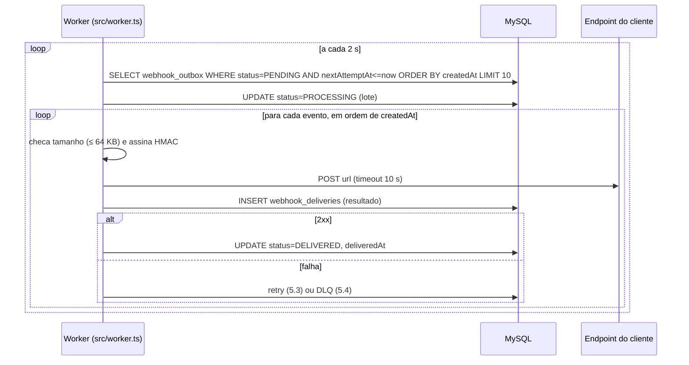

# FDD — Sistema de Webhooks de Notificação de Pedidos

| Campo | Valor |
| --- | --- |
| **Autor** | Adilson Barbosa |
| **Status** | Pronto para revisão de design (sessão com Bruno e Diego, [09:50] Larissa) |
| **Data** | 02-11-2026 |
| **Documentos relacionados** | [PRD](PRD.md) · [RFC](RFC.md) · [ADRs](adrs/README.md) · [Tracker](TRACKER.md) |

> **Convenção de rastreabilidade.** Cada regra cita a origem: `[hh:mm] Nome` para a transcrição, ou um caminho de arquivo para o código. Detalhes de implementação que a reunião não fixou, mas que são necessários para codar, aparecem marcados com **[D]** (decisão de desenho). Cada um indica a decisão da qual deriva e deve ser confirmado na sessão de revisão de design.

---

## 1. Contexto e motivação técnica

Clientes B2B fazem polling em `GET /orders` para detectar mudanças de status ([09:00] Marcos) e querem ser notificados em menos de 10 s ([09:02] Marcos). O OMS não tem eventos, filas, worker nem cliente HTTP de saída. Hoje, a mudança de status acontece numa única transação em `OrderService.changeStatus` (`src/modules/orders/order.service.ts:131-178`). Essa transação valida a transição pela máquina de estados (`src/modules/orders/order.status.ts:3-10`), debita ou repõe estoque, atualiza `orders` e insere em `order_status_history`.

A feature acrescenta a essa transação a gravação de um evento numa outbox ([ADR-001](adrs/ADR-001-outbox-no-mysql.md)). Um worker em outro processo ([ADR-002](adrs/ADR-002-worker-separado-com-polling.md)) faz a entrega HTTP assinada ([ADR-004](adrs/ADR-004-assinatura-hmac-sha256-com-secret-por-endpoint.md)) com retry e DLQ ([ADR-003](adrs/ADR-003-retry-com-backoff-exponencial-e-dlq.md)) e garantia at-least-once ([ADR-005](adrs/ADR-005-entrega-at-least-once-com-x-event-id.md)). Tudo isso reutiliza os padrões do projeto ([ADR-006](adrs/ADR-006-reuso-dos-padroes-existentes.md)).

## 2. Objetivos técnicos

| # | Objetivo | Origem |
| --- | --- | --- |
| OT-1 | Primeira tentativa de entrega em até ~2 s após o commit da mudança de status (no máximo um ciclo de polling); bem abaixo de 10 s | [09:02] Marcos, [09:10] Larissa |
| OT-2 | Zero divergência entre mudanças de status confirmadas e eventos registrados (atomicidade) | [09:06] Diego, [09:40] Bruno |
| OT-3 | Nenhuma chamada HTTP dentro da transação de status | [09:04] Bruno |
| OT-4 | Todo evento termina como entregue ou na DLQ, após até 5 reenvios em ~14,6 h | [09:17] Larissa |
| OT-5 | Toda requisição assinada com HMAC-SHA256 com a secret do endpoint | [09:22] Sofia |
| OT-6 | Nenhuma dependência nova no `package.json`: Node 20 já traz `fetch` e `crypto` | [09:29] Bruno; `package.json` (`engines`) |

## 3. Escopo e exclusões

**Incluso:** CRUD de configuração de webhooks; rotação de secret; publicação na outbox dentro de `changeStatus`; worker com polling, retry, backoff e DLQ; assinatura HMAC; histórico de entregas; replay administrativo da DLQ; logs, métricas e correlação.

**Excluído (com origem):**

| Item | Situação | Origem |
| --- | --- | --- |
| Webhooks de entrada (cliente → OMS) | Fora do escopo: só saída | [09:02] Marcos |
| E-mail ao cliente quando o webhook falha | Próxima fase | [09:37] Larissa |
| Rate limiting de saída | Observar e decidir depois | [09:39] Larissa |
| Dashboard visual | Projeto separado do time de frontend | [09:40] Larissa |
| Múltiplos workers / ordem global | Futuro; single-worker | [09:13] Diego, [09:13] Larissa |
| Arquivamento da outbox (~30 dias) | Fora desta feature | [09:08] Diego |
| Restrição de papel no CRUD | "Mais pra frente" | [09:37] Sofia |
| Evento na **criação** do pedido | Não discutido; só mudanças de status (`order.status_changed`) | [09:43] Diego |

## 4. Modelo de dados

Novos models em `prisma/schema.prisma`, seguindo o padrão existente: `id String @id @default(uuid()) @db.Char(36)` ([09:51] Larissa), tabelas snake_case via `@@map` e uma nova migration em `prisma/migrations/`.

| Tabela | Campos principais | Origem |
| --- | --- | --- |
| `webhook_endpoints` **[D]** (nome) | `id`, `customerId` (FK `customers`), `url`, `events` (Json: lista de `OrderStatus`), `secret`, `previousSecret?`, `previousSecretExpiresAt?`, `active` (default `true`), `createdAt`, `updatedAt`. Índice em `customerId` | url+secret+customer_id+ativo: [09:21] Bruno/Sofia; eventos: [09:33] Marcos; rotação: [09:21] Sofia |
| `webhook_outbox` | `id`, `eventId` (UUID do evento), `webhookId` (FK), `orderId`, `eventType`, `payload` (Json, snapshot), `status` (`PENDING`, `PROCESSING`, `DELIVERED`, `FAILED`), `attempts` (int, default 0), `nextAttemptAt`, `lastError?`, `requestId?`, `createdAt`, `deliveredAt?`. Índices em `status` e `createdAt` | Tabela e índices: [09:06] Diego, [09:08] Diego; snapshot: [09:52] Larissa; uma linha por webhook: decisão T-AMB-04 (RFC §5.8) |
| `webhook_dead_letter` | `id`, `outboxId` (FK, único), `webhookId`, `eventId`, `payload` (Json), `reason`, `failedAt`, `replayedAt?`, `replayedById?` (FK `users`) | [09:18] Diego; auditoria do replay: [09:36] Sofia |
| `webhook_deliveries` **[D]** (nome) | `id`, `outboxId`, `webhookId`, `eventId`, `attempt` (1..6), `success`, `statusCode?`, `responseBody?` (truncado em 4 KB **[D]**), `durationMs`, `error?`, `createdAt`. Índice `(webhookId, createdAt)` | "sucesso/falha, payload, response, tempo de resposta": [09:34] Marcos |

O payload em Json segue o precedente de `Customer.address Json` (`prisma/schema.prisma`). O status `FAILED` da outbox marca a linha encerrada; a falha definitiva em si fica registrada em `webhook_dead_letter` ([09:18] Diego). O worker nunca lê linhas `FAILED`.

## 5. Fluxos detalhados

### 5.1 Criação do evento na outbox (dentro de `changeStatus`)

```mermaid
sequenceDiagram
  participant C as Cliente HTTP (operador)
  participant OC as OrderController
  participant OS as OrderService.changeStatus
  participant P as publishWebhookEvent(tx,...)
  participant DB as MySQL (transação)
  C->>OC: PATCH /api/v1/orders/:id/status
  OC->>OS: changeStatus(id, input, userId, requestId)
  OS->>DB: BEGIN; valida transição; estoque; UPDATE orders; INSERT order_status_history
  OS->>P: publishWebhookEvent(tx, order, from, to, requestId)
  P->>DB: SELECT webhook_endpoints WHERE customerId AND active AND to ∈ events
  alt nenhum webhook interessado
    P-->>OS: nada inserido
  else 1..N webhooks
    P->>DB: INSERT webhook_outbox (1 linha por webhook, mesmo eventId, status PENDING, nextAttemptAt = now)
  end
  OS->>DB: COMMIT (falha em qualquer passo → ROLLBACK de tudo)
```

1. `publishWebhookEvent(tx, order, fromStatus, toStatus)` é uma função exportada pelo módulo de webhooks que recebe o `tx` da transação corrente; o `OrderService` não recebe nenhum repositório novo ([09:41] Bruno, [09:41] Diego). **[D]** Ela ganha um 5º parâmetro opcional, `requestId`, que não estava na proposta do Bruno: sem ele, o evento não se liga à requisição que o gerou, e a correlação da §9.3 não fecha.
2. Ela é chamada **depois** do `INSERT` em `order_status_history` e antes do re-read final (`order.service.ts:159-176`).
3. O filtro acontece na inserção: o webhook só entra se estiver `active` e se `toStatus` estiver na sua lista `events` ([09:34] Bruno).
4. Um `eventId = randomUUID()` é gerado por mudança de status e repetido em todas as linhas ([09:25] Diego; T-AMB-04).
5. O payload (§6.9) é renderizado agora, como snapshot ([09:52] Larissa).
6. Qualquer erro propaga e desfaz a mudança de status ([09:40] Bruno).

### 5.2 Processamento pelo worker



- Ponto de entrada `src/worker.ts` e script `npm run worker` ([09:11] Larissa). Lógica em `src/modules/webhooks/webhook.worker.ts` ([09:28] Bruno).
- O worker importa o `prisma` exportado por `src/config/database.ts`, na mesma `DATABASE_URL`. Como o módulo cria a instância ao ser importado (linha 10), cada processo já tem a sua: é a "instância nova porque é outro processo" de [09:30] Bruno. Chamar `createPrismaClient()` de novo criaria um segundo cliente no mesmo processo.
- Polling a cada 2 s ([09:09] Diego) em lote pequeno ([09:08] Diego); o tamanho de 10 é **[D]**. Entregas em sequência, por ordem de `createdAt`, e só um worker ([09:12] Diego).
- Sucesso é qualquer HTTP 2xx. Falha é qualquer outro status, erro de rede ou timeout de 10 s ([09:42] Diego). Redirects não são seguidos (`redirect: 'manual'`) **[D]**, para evitar o envio a destinos não cadastrados.
- **Recuperação de crash [D]:** na inicialização, linhas `PROCESSING` voltam para `PENDING`. Como a garantia é at-least-once, reenviar é seguro ([ADR-005](adrs/ADR-005-entrega-at-least-once-com-x-event-id.md)).
- **Payload acima de 64 KB:** vai direto para a DLQ, sem tentativa e sem retry, com o motivo `WEBHOOK_PAYLOAD_TOO_LARGE`. A regra "erro, não trunca" é de [09:23] Sofia e [09:24] Larissa. A checagem é feita no worker e não na inserção **[D]**, para que um payload grande nunca desfaça uma mudança de status válida.

### 5.3 Retry com backoff

Após a falha da tentativa `n` (sendo `attempts` o número de tentativas já feitas):

| Tentativa falha | Próxima tentativa em | Origem |
| --- | --- | --- |
| Envio inicial (1ª chamada) | +1 min (reenvio 1) | [09:17] Diego |
| Reenvio 1 | +5 min (reenvio 2) | |
| Reenvio 2 | +30 min (reenvio 3) | |
| Reenvio 3 | +2 h (reenvio 4) | |
| Reenvio 4 | +12 h (reenvio 5) | |
| Reenvio 5 | → DLQ (5.4) | [09:15] Diego |

Em cada falha, `attempts++`, `lastError` é atualizado, `status=PENDING` e `nextAttemptAt = now + backoff[attempts-1]`. São até 6 chamadas HTTP, numa janela de ~14,6 h entre a primeira falha e a última tentativa (interpretação de "5 tentativas", ver [ADR-003](adrs/ADR-003-retry-com-backoff-exponencial-e-dlq.md)). O resumo final da reunião diz "total 5 tentativas" ([09:48] Larissa), o que conflita com essa leitura; a contagem será confirmada no design review. Se mudar, só o tamanho da tabela de backoff muda.

### 5.4 Dead Letter Queue e replay

1. **Ida para a DLQ.** Numa única transação: a linha da outbox recebe `status=FAILED`, e um registro com payload, motivo e `failedAt` é inserido em `webhook_dead_letter` ([09:18] Diego). O log `webhook_moved_to_dead_letter` é gravado em nível `warn`.
2. **Replay** (`POST /api/v1/admin/webhooks/dead-letter/:id/replay`, só ADMIN). Numa transação: a linha da outbox volta a `status=PENDING`, com `attempts=0` e `nextAttemptAt=now` ("recoloca na outbox como pendente", [09:18] Diego). O registro da DLQ recebe `replayedAt` e `replayedById` ([09:36] Sofia). O log de auditoria `webhook_dead_letter_replayed` registra `userId`, `deadLetterId`, `eventId` e `requestId`.
3. Pedir replay de um item já reprocessado retorna `409 WEBHOOK_DEAD_LETTER_ALREADY_REPLAYED` **[D]**, para não duplicar eventos sem querer.
4. O evento reprocessado mantém o mesmo `eventId`, então o cliente consegue deduplicar ([ADR-005](adrs/ADR-005-entrega-at-least-once-com-x-event-id.md)).

### 5.5 Rotação de secret

1. O cliente chama o endpoint de rotação (§6.6).
2. `previousSecret` recebe a secret atual, e `previousSecretExpiresAt` fica em `now + 24 h` ([09:21] Sofia).
3. Uma nova secret é gerada com `crypto.randomBytes(32)` em hexadecimal **[D]** e devolvida **uma única vez**.
4. **Assinatura durante a convivência [D]:** para a secret antiga continuar "válida em paralelo", o worker envia as duas assinaturas no `X-Signature`, separadas por vírgula, até a expiração. O cliente aceita a requisição se qualquer uma conferir.
5. Rotacionar de novo dentro das 24 h descarta a secret mais antiga **[D]**: só a imediatamente anterior convive com a atual.

## 6. Contratos públicos

Base: `/api/v1`. Autenticação: `Authorization: Bearer <JWT>`, via `authenticate` (`src/middlewares/auth.middleware.ts`). Erros seguem o envelope existente `{ "error": { "code", "message", "details?" } }` (`src/middlewares/error.middleware.ts:14-24`). Os campos da API de gestão são camelCase, como no resto da API (ex.: `toStatus` em `src/modules/orders/order.schemas.ts`). O payload **enviado ao cliente** é snake_case, conforme definido em [09:43] Diego.

### 6.1 `POST /api/v1/webhooks`: cadastrar webhook

Origem: [09:31] Marcos, [09:32] Larissa (`customerId` no body, conforme decisão T-AMB-02). Qualquer papel autenticado ([09:37] Sofia).

```http
POST /api/v1/webhooks
Authorization: Bearer eyJhbGciOi...
Content-Type: application/json

{
  "customerId": "6f1c2e0a-3b7d-4c55-9a1e-2d8f4b6c9e01",
  "url": "https://hooks.atlascomercial.com.br/oms/orders",
  "events": ["SHIPPED", "DELIVERED"]
}
```

`201 Created`: a `secret` é devolvida **somente aqui** e na rotação.
```json
{
  "id": "0b8e7f52-1c3a-4d9e-8f21-7a6b5c4d3e2f",
  "customerId": "6f1c2e0a-3b7d-4c55-9a1e-2d8f4b6c9e01",
  "url": "https://hooks.atlascomercial.com.br/oms/orders",
  "events": ["SHIPPED", "DELIVERED"],
  "active": true,
  "secret": "9f2c4e6a8b0d1f3e5a7c9b1d3f5e7a9c0b2d4f6e8a1c3e5b7d9f1a3c5e7b9d1f",
  "createdAt": "2026-11-20T13:58:04.112Z",
  "updatedAt": "2026-11-20T13:58:04.112Z"
}
```
| Status | Quando |
| --- | --- |
| 201 | Criado |
| 400 `VALIDATION_ERROR` | Corpo inválido: `customerId` não UUID, `events` vazio ou com status inexistente (Zod, `src/middlewares/validate.middleware.ts`) |
| 400 `WEBHOOK_INVALID_URL` | URL não-HTTPS ou malformada ([09:23] Sofia) |
| 401 `UNAUTHORIZED` | Sem token ou token inválido |
| 404 `WEBHOOK_CUSTOMER_NOT_FOUND` | `customerId` inexistente |

### 6.2 `GET /api/v1/webhooks?customerId=...`: listar webhooks do customer

Origem: [09:33] Bruno. `customerId` vai na query porque GET não tem body (T-AMB-02). A resposta usa o formato paginado existente (`src/shared/http/response.ts`), com `page` e `pageSize` como nas outras listagens **[D]**. A secret nunca é exposta.

`200 OK`
```json
{
  "data": [
    {
      "id": "0b8e7f52-1c3a-4d9e-8f21-7a6b5c4d3e2f",
      "customerId": "6f1c2e0a-3b7d-4c55-9a1e-2d8f4b6c9e01",
      "url": "https://hooks.atlascomercial.com.br/oms/orders",
      "events": ["SHIPPED", "DELIVERED"],
      "active": true,
      "secretRotationExpiresAt": null,
      "createdAt": "2026-11-20T13:58:04.112Z",
      "updatedAt": "2026-11-20T13:58:04.112Z"
    }
  ],
  "pagination": { "page": 1, "pageSize": 20, "total": 1, "totalPages": 1 }
}
```
| Status | Quando |
| --- | --- |
| 200 | Lista (pode ser vazia) |
| 400 `VALIDATION_ERROR` | `customerId` ausente ou não UUID |
| 401 `UNAUTHORIZED` | Sem token |

### 6.3 `PATCH /api/v1/webhooks/:id`: editar webhook

Origem: [09:33] Bruno. Todos os campos são opcionais: `url`, `events`, `active` ("estado ativo", [09:21] Bruno). Mudanças valem para eventos **futuros**. As linhas já gravadas na outbox não são alteradas, porque o payload é um snapshot ([09:52] Larissa).

```http
PATCH /api/v1/webhooks/0b8e7f52-1c3a-4d9e-8f21-7a6b5c4d3e2f
Content-Type: application/json

{ "events": ["PAID", "SHIPPED", "DELIVERED"], "active": true }
```
`200 OK`: mesmo corpo do item de §6.2, já atualizado.

| Status | Quando |
| --- | --- |
| 200 | Atualizado |
| 400 `VALIDATION_ERROR` / `WEBHOOK_INVALID_URL` | Corpo inválido / URL não-HTTPS |
| 401 `UNAUTHORIZED` | Sem token |
| 404 `WEBHOOK_NOT_FOUND` | `id` inexistente |

### 6.4 `DELETE /api/v1/webhooks/:id`: remover webhook

Origem: [09:33] Bruno. **[D]** A remoção apaga a configuração, e as linhas `PENDING` da outbox desse webhook são removidas em cascata. O histórico de entregas e os itens da DLQ ficam guardados para auditoria, com `webhookId` mantido como referência.

`204 No Content` (sem corpo).

| Status | Quando |
| --- | --- |
| 204 | Removido |
| 401 `UNAUTHORIZED` | Sem token |
| 404 `WEBHOOK_NOT_FOUND` | `id` inexistente |

### 6.5 `GET /api/v1/webhooks/:id/deliveries`: histórico de entregas

Origem: [09:34] Marcos. Retorna as **últimas 100** tentativas, da mais recente para a mais antiga, com sucesso ou falha, payload, resposta e tempo de resposta.

- **Interpretação:** o Marcos pediu "os últimos 100 webhooks que vocês mandaram". Aqui a unidade é a **tentativa** (cada retry é uma linha), porque é o que mostra ao cliente por que um envio falhou. Com retries, 100 tentativas podem cobrir bem menos de 100 eventos. A alternativa, 100 **eventos** com as tentativas agrupadas, fica para o design review.
- O `requestPayload` não é copiado em `webhook_deliveries`: vem do snapshot em `webhook_outbox.payload`, via `outboxId`.

`200 OK`
```json
{
  "data": [
    {
      "id": "c1d2e3f4-a5b6-4c7d-8e9f-0a1b2c3d4e5f",
      "eventId": "3a7c1e9b-5d2f-4a8e-b6c4-1f9d7e3b5a20",
      "attempt": 2,
      "success": false,
      "statusCode": 503,
      "durationMs": 412,
      "error": "HTTP 503",
      "requestPayload": { "event_id": "3a7c1e9b-5d2f-4a8e-b6c4-1f9d7e3b5a20", "event_type": "order.status_changed", "...": "..." },
      "responseBody": "Service Unavailable",
      "createdAt": "2026-11-20T14:04:13.020Z"
    }
  ]
}
```
| Status | Quando |
| --- | --- |
| 200 | Histórico (pode ser vazio) |
| 401 `UNAUTHORIZED` | Sem token |
| 404 `WEBHOOK_NOT_FOUND` | Webhook inexistente |

### 6.6 `POST /api/v1/webhooks/:id/secret/rotate`: rotacionar secret **[D]** (rota)

Origem: "endpoint pro cliente conseguir pedir nova secret pela API" ([09:21] Sofia). Sem corpo.

`200 OK`
```json
{
  "id": "0b8e7f52-1c3a-4d9e-8f21-7a6b5c4d3e2f",
  "secret": "4e1a9c7b3d5f2e8a6c0b4d2f8e6a1c3b5d7f9e2a4c6b8d0f1e3a5c7b9d2f4e6a",
  "previousSecretExpiresAt": "2026-11-21T14:10:00.000Z"
}
```
| Status | Quando |
| --- | --- |
| 200 | Nova secret emitida; a anterior vale até `previousSecretExpiresAt` |
| 401 `UNAUTHORIZED` | Sem token |
| 404 `WEBHOOK_NOT_FOUND` | Webhook inexistente |

### 6.7 `POST /api/v1/admin/webhooks/dead-letter/:id/replay`: replay da DLQ

Origem: [09:18] Diego, [09:35] Diego. **Só ADMIN**, via `requireRole('ADMIN')` ([09:36] Sofia, [09:36] Larissa). Sem corpo.

`202 Accepted`: o evento volta para a fila, e a entrega acontece de forma assíncrona.
```json
{
  "deadLetterId": "e7f6d5c4-b3a2-4918-8a7b-6c5d4e3f2a10",
  "outboxId": "a9b8c7d6-e5f4-4321-9a8b-7c6d5e4f3a21",
  "eventId": "3a7c1e9b-5d2f-4a8e-b6c4-1f9d7e3b5a20",
  "status": "PENDING",
  "replayedAt": "2026-11-21T09:12:44.501Z",
  "replayedById": "5d4c3b2a-1f0e-4d9c-8b7a-6f5e4d3c2b1a"
}
```
| Status | Quando |
| --- | --- |
| 202 | Recolocado na outbox |
| 401 `UNAUTHORIZED` | Sem token |
| 403 `FORBIDDEN` | Usuário não é ADMIN (`src/middlewares/auth.middleware.ts:49-61`) |
| 404 `WEBHOOK_DEAD_LETTER_NOT_FOUND` | Item inexistente |
| 409 `WEBHOOK_DEAD_LETTER_ALREADY_REPLAYED` | Item já reprocessado **[D]** |

### 6.8 Requisição enviada ao cliente (contrato de saída)

```http
POST https://hooks.atlascomercial.com.br/oms/orders
Content-Type: application/json
X-Event-Id: 3a7c1e9b-5d2f-4a8e-b6c4-1f9d7e3b5a20
X-Webhook-Id: 0b8e7f52-1c3a-4d9e-8f21-7a6b5c4d3e2f
X-Timestamp: 2026-11-20T14:03:13.906Z
X-Signature: 8d2f6a...e41b
```
| Header | Conteúdo | Origem |
| --- | --- | --- |
| `X-Event-Id` | UUID do evento; o mesmo em retries e replay | [09:25] Diego |
| `X-Signature` | HMAC-SHA256 (hex) do **corpo bruto** com a secret do endpoint. Durante a rotação, duas assinaturas separadas por vírgula **[D]** | [09:20] Sofia, [09:22] Sofia |
| `X-Timestamp` | Momento do **envio**, em ISO 8601 | [09:44] Diego |
| `X-Webhook-Id` | `id` do webhook cadastrado | [09:44] Sofia |
| `Content-Type` | `application/json` | [09:44] Diego |

**Resposta esperada do cliente:** qualquer 2xx em até 10 s ([09:42] Diego). O corpo da resposta é ignorado, exceto para o histórico de entregas.

**Verificação no cliente:** recalcular o HMAC-SHA256 do corpo bruto com a secret, comparar em tempo constante e deduplicar pelo `X-Event-Id`.

### 6.9 Payload do evento

Origem: [09:43] Diego. É enxuto e não inclui `items`; o cliente consulta `GET /api/v1/orders/:id` se quiser detalhes. O tamanho máximo é 64 KB ([09:24] Larissa).

```json
{
  "event_id": "3a7c1e9b-5d2f-4a8e-b6c4-1f9d7e3b5a20",
  "event_type": "order.status_changed",
  "timestamp": "2026-11-20T14:03:12.481Z",
  "order_id": "d4c3b2a1-9e8f-4a7b-8c6d-5e4f3a2b1c0d",
  "order_number": "ORD-000123",
  "from_status": "PROCESSING",
  "to_status": "SHIPPED",
  "customer_id": "6f1c2e0a-3b7d-4c55-9a1e-2d8f4b6c9e01",
  "total_cents": 15990
}
```
`timestamp` é o instante da mudança de status (snapshot). Já `X-Timestamp` é o instante do envio, que muda a cada retry. Os campos vêm de `Order` (`id`, `orderNumber`, `customerId`, `totalCents`) em `prisma/schema.prisma`.

## 7. Matriz de erros

Os erros da API usam `AppError` (`src/shared/errors/app-error.ts`) e as subclasses de `src/shared/errors/http-errors.ts`, com prefixo `WEBHOOK_` ([09:28] Bruno, [09:29] Larissa). `NotFoundError` tem o código fixo `NOT_FOUND` (`http-errors.ts:27-31`). Por isso, os 404 do módulo instanciam `AppError` diretamente. `BadRequestError` e `ConflictError` já aceitam um código customizado.

Só `WEBHOOK_NOT_FOUND` e `WEBHOOK_INVALID_URL` foram citados na reunião ([09:28] Bruno). Os demais nomes são **[D]**: seguem o prefixo e o estilo pedidos, mas a condição que cada um cobre é que vem da reunião.

| Código | HTTP | Onde | Classe | Mensagem / condição |
| --- | --- | --- | --- | --- |
| `WEBHOOK_NOT_FOUND` | 404 | API | `AppError` | Webhook `:id` inexistente ([09:28] Bruno) |
| `WEBHOOK_CUSTOMER_NOT_FOUND` **[D]** | 404 | API | `AppError` | `customerId` informado não existe |
| `WEBHOOK_INVALID_URL` | 400 | API | `BadRequestError(msg, 'WEBHOOK_INVALID_URL')` | URL malformada ou com esquema diferente de `https` ([09:23] Sofia, [09:28] Bruno) |
| `WEBHOOK_DEAD_LETTER_NOT_FOUND` **[D]** | 404 | API | `AppError` | Item da DLQ inexistente |
| `WEBHOOK_DEAD_LETTER_ALREADY_REPLAYED` **[D]** | 409 | API | `ConflictError(msg, '...')` | Item já reprocessado |
| `WEBHOOK_PAYLOAD_TOO_LARGE` **[D]** | — | Worker | Motivo na DLQ | Payload > 64 KB; vai direto para a DLQ ([09:23] Sofia, [09:24] Larissa) |
| `WEBHOOK_DELIVERY_TIMEOUT` **[D]** | — | Worker | `lastError` / motivo na DLQ | Sem resposta em 10 s ([09:42] Diego) |
| `WEBHOOK_DELIVERY_HTTP_ERROR` **[D]** | — | Worker | `lastError` / motivo na DLQ | Cliente respondeu com status diferente de 2xx |
| `WEBHOOK_DELIVERY_NETWORK_ERROR` **[D]** | — | Worker | `lastError` / motivo na DLQ | DNS, conexão recusada, TLS |
| `WEBHOOK_MAX_ATTEMPTS_EXCEEDED` **[D]** | — | Worker | Motivo na DLQ | 5 reenvios esgotados ([09:15] Diego) |

Erros genéricos reaproveitados sem mudança: `VALIDATION_ERROR` (400, Zod), `UNAUTHORIZED` (401) e `FORBIDDEN` (403, `requireRole`).

**Nota sobre `WEBHOOK_INVALID_URL`.** A Sofia descreveu a regra de HTTPS como "validação no schema Zod" ([09:23] Sofia). Só que o `validate` middleware sempre converte erros do Zod em `VALIDATION_ERROR` (`src/middlewares/validate.middleware.ts:26-32`). Para emitir o código pedido pelo Bruno ([09:28] Bruno) sem alterar o middleware ([09:29] Bruno), o Zod valida o formato de URL e o service valida o esquema `https`. **[D]**

`WEBHOOK_SECRET_REQUIRED`, citado como exemplo em [09:28] Bruno, **não** entra: a secret é sempre gerada pelo servidor ([09:31] Marcos), então não existe cenário em que ela falte.

## 8. Estratégias de resiliência

| Aspecto | Estratégia | Origem |
| --- | --- | --- |
| Isolamento da transação | Nenhum I/O de rede na transação de status; só um INSERT na outbox | [09:04] Bruno, [ADR-001](adrs/ADR-001-outbox-no-mysql.md) |
| Timeout | 10 s por chamada, via `AbortSignal.timeout(10_000)` no `fetch` nativo | [09:42] Diego |
| Retries | 5 reenvios, com backoff 1m/5m/30m/2h/12h | [09:17] Larissa |
| Fallback | DLQ em tabela separada e replay manual por ADMIN | [09:18] Diego, [09:36] Sofia |
| Idempotência | `X-Event-Id` estável; dedup no cliente | [09:26] Larissa |
| Crash do worker | Linhas `PROCESSING` voltam a `PENDING` na inicialização **[D]** | at-least-once, [ADR-005](adrs/ADR-005-entrega-at-least-once-com-x-event-id.md) |
| Reinício da API | Não afeta entregas: o worker é outro processo | [09:11] Diego |
| Shutdown do worker | SIGINT/SIGTERM: termina o lote atual, `prisma.$disconnect()` e sai, no mesmo padrão de `src/server.ts` | `src/server.ts` |
| Limite de payload | > 64 KB: DLQ sem tentativa (não trunca) | [09:23] Sofia |
| Isolamento entre clientes | **Parcial.** Um cliente **fora do ar** não bloqueia os outros: cada linha tem retry próprio, reagendado por `nextAttemptAt`. Um cliente **lento** bloqueia: as entregas do lote são sequenciais, e cada uma pode levar até 10 s. Ver o risco "cliente lento segura o worker" (§13) | [09:04] Bruno (motivação) **[D]** |

## 9. Observabilidade

O projeto hoje tem só logs Pino estruturados e `X-Request-Id` (`src/shared/logger/index.ts`, `src/middlewares/request-logger.middleware.ts`). Não há métricas nem tracing. Como a decisão foi não adicionar bibliotecas ([09:29] Bruno), a observabilidade da feature se apoia em logs estruturados e em consultas às próprias tabelas.

### 9.1 Logs (Pino)

Os logs do worker usam um child logger `logger.child({ component: 'webhook-worker' })`.

| Evento (`msg`) | Nível | Campos |
| --- | --- | --- |
| `webhook_event_enqueued` | info | `eventId`, `orderId`, `webhookIds[]`, `fromStatus`, `toStatus`, `requestId` |
| `webhook_delivery_succeeded` | info | `eventId`, `webhookId`, `outboxId`, `attempt`, `statusCode`, `durationMs`, `latencyMs` |
| `webhook_delivery_failed` | warn | os anteriores + `errorCode` (`WEBHOOK_DELIVERY_*`), `nextAttemptAt` |
| `webhook_moved_to_dead_letter` | warn | `eventId`, `webhookId`, `outboxId`, `reason` |
| `webhook_dead_letter_replayed` | info | `deadLetterId`, `eventId`, `userId`, `requestId`: **auditoria do replay** ([09:36] Sofia) |
| `webhook_secret_rotated` | info | `webhookId`, `userId`, `previousSecretExpiresAt` (nunca a secret) |
| `webhook_worker_started` / `webhook_worker_stopped` | info | `pollIntervalMs`, `batchSize`, `recoveredProcessing` |
| `webhook_worker_heartbeat` **[D]** | info | `cycles`, `pendingCount`; emitido a cada 30 ciclos (~1 min) |

Secrets nunca são logadas. O caminho `*.secret` e `*.previousSecret` entra nos `redactPaths` de `src/shared/logger/index.ts`.

### 9.2 Métricas

As métricas são derivadas dos logs e das tabelas, sem biblioteca nova. Não há Prometheus nem outro coletor: cada indicador é uma consulta SQL ou uma agregação sobre os logs Pino.

| Indicador | Como obter | Cálculo | Alvo / alerta |
| --- | --- | --- | --- |
| Latência de entrega | Agregação de log (campo `latencyMs` de `webhook_delivery_succeeded`) | `entregue_em - outbox.createdAt` na 1ª tentativa bem-sucedida | p95 < 10 s **[D]**, derivado do "abaixo de 10 segundos" de [09:02] Marcos |
| Eventos pendentes | Consulta SQL | `COUNT(*) FROM webhook_outbox WHERE status='PENDING'` | Tendência de alta indica worker parado ou lento |
| Idade do pendente mais antigo | Consulta SQL | `now - MIN(createdAt) WHERE status='PENDING' AND attempts=0` | > 10 s indica que o worker não está acompanhando |
| Taxa de falha por webhook | Consulta SQL | `webhook_deliveries` agrupado por `webhookId` e `success` | Acompanhamento; sem limiar definido na reunião |
| Itens na DLQ | Consulta SQL | `COUNT(*) FROM webhook_dead_letter WHERE replayedAt IS NULL` | Qualquer crescimento merece investigação |
| Heartbeat do worker | Log `webhook_worker_heartbeat` em nível `info`, a cada 30 ciclos (~1 min) **[D]** | Presença do log no último minuto | Ausência indica worker caído. Em `debug` ele sumiria, porque o `LOG_LEVEL` padrão é `info` (`src/config/env.ts:6`) |

### 9.3 Tracing (correlação)

Não há infraestrutura de tracing distribuído, e o projeto não deve adicioná-la ([09:29] Bruno). A correlação ponta a ponta é feita por IDs nos logs e nas tabelas:

`X-Request-Id` da chamada `PATCH /orders/:id/status` → `webhook_outbox.requestId` → `eventId` (também em `X-Event-Id`, visível para o cliente) → `outboxId`/`webhookId` → `webhook_deliveries.id`.

Para isso, `OrderController.changeStatus` passa `req.id` ao service. Hoje o request id não sai da camada HTTP (`src/middlewares/request-logger.middleware.ts`), e esse é um ajuste pequeno no fluxo de pedidos (§10).

## 10. Integração com o sistema existente

| # | Arquivo existente | Como o módulo de webhooks se integra |
| --- | --- | --- |
| 1 | `src/modules/orders/order.service.ts` | **Ponto crítico.** Em `changeStatus` (linhas 131-178), depois do `tx.orderStatusHistory.create` (159-167) e antes do re-read final, chamar `publishWebhookEvent(tx, order, from, to, requestId)`. O `order` carregado na linha 132 já tem `customerId`, `orderNumber` e `totalCents`. A assinatura de `changeStatus` ganha um parâmetro opcional `requestId` **[D]** (§5.1). O `OrderService` não recebe repositório novo ([09:41] Bruno, [09:41] Diego). A falha da função propaga e desfaz a transação ([09:40] Bruno). |
| 2 | `src/modules/orders/order.controller.ts` | `changeStatus` (linha 41) passa `req.id` como `requestId`, para a correlação (§9.3). A resposta HTTP não muda. |
| 3 | `src/modules/orders/order.status.ts` | Sem alteração. A máquina de estados continua sendo a única fonte de transições válidas: só transições aprovadas por `canTransition` geram evento. Os valores aceitos em `events` são o enum `OrderStatus`. |
| 4 | `src/app.ts` | Em `buildControllers` (linhas 26-53), instanciar `WebhookRepository`, `WebhookService` e `WebhookController`, no mesmo padrão manual dos outros módulos, e incluí-los no objeto `Controllers`. |
| 5 | `src/routes/index.ts` | Registrar `router.use('/webhooks', buildWebhookRouter(...))` e `router.use('/admin/webhooks', buildWebhookAdminRouter(...))`, ao lado das rotas existentes (linhas 24-28), sob `/api/v1`. |
| 6 | `src/middlewares/auth.middleware.ts` | `authenticate` em todas as rotas do módulo. `requireRole('ADMIN')` (linhas 49-61) no router de admin ([09:36] Larissa). Hoje ele só é usado em `src/modules/users/user.routes.ts:15`. |
| 7 | `src/shared/errors/app-error.ts` e `src/shared/errors/http-errors.ts` | Reuso sem alteração: `AppError` para os 404 com código `WEBHOOK_*`, porque `NotFoundError` fixa `NOT_FOUND`; `BadRequestError` e `ConflictError` para os demais (§7). Exportar pelo barrel `src/shared/errors/index.ts`. |
| 8 | `src/middlewares/error.middleware.ts` | **Sem alteração.** Os erros `WEBHOOK_*` são `AppError` e caem no ramo das linhas 15-24 ([09:29] Bruno). |
| 9 | `src/middlewares/validate.middleware.ts` | Reuso para os schemas Zod do módulo (`webhook.schemas.ts`): body, params (`id` UUID) e query (`customerId`, `page`, `pageSize`). |
| 10 | `src/shared/logger/index.ts` | O worker e o módulo usam o `logger` existente (child logger no worker). Acrescentar `*.secret` e `*.previousSecret` em `redactPaths` (linhas 4-11). |
| 11 | `src/shared/http/response.ts` | `paginated()` na listagem de webhooks (§6.2). |
| 12 | `src/config/database.ts` | Sem alteração. O worker importa o `prisma` exportado (linha 10), que já é uma instância própria por processo ([09:30] Bruno). |
| 13 | `src/config/env.ts` | Novas variáveis com default, validadas no `envSchema`: `WEBHOOK_POLL_INTERVAL_MS=2000` ([09:09] Diego), `WEBHOOK_HTTP_TIMEOUT_MS=10000` ([09:42] Diego), `WEBHOOK_BATCH_SIZE=10` **[D]**. Atenção: o worker importa o `env` e herda a exigência de `JWT_SECRET` (linha 8), mesmo sem usá-lo. Basta o worker rodar com o mesmo `.env` da API. |
| 14 | `src/server.ts` | Modelo para o novo `src/worker.ts`: bootstrap, `logger.fatal` em falha, shutdown em SIGINT/SIGTERM com `prisma.$disconnect()` ([09:11] Larissa). |
| 15 | `prisma/schema.prisma` | Novos models (§4), relação `Customer` → `WebhookEndpoint[]` e nova migration. |
| 16 | `package.json` | Scripts `worker` (`node --env-file=.env dist/worker.js`) e `worker:dev` (`tsx watch --env-file=.env src/worker.ts`), seguindo `start`/`dev` ([09:11] Larissa). Nenhuma dependência nova. |
| 17 | `tests/setup.ts` | O `beforeEach` (linhas 8-16) apaga as tabelas na ordem das FKs. As novas tabelas entram no início, nesta ordem: `webhookDeadLetter` → `webhookDelivery` → `webhookOutbox` → `webhookEndpoint`. Assim elas saem antes de `customer` (FK de `webhook_endpoints`) e de `user` (FK `replayedById` da DLQ). |

**Novos arquivos** (padrão de módulo, [09:27] Bruno): `src/modules/webhooks/webhook.{routes,controller,service,repository,schemas}.ts`, `webhook.publisher.ts` (com `publishWebhookEvent`), `webhook.worker.ts`, `webhook.signer.ts` e `src/worker.ts`.

## 11. Dependências e compatibilidade

| Item | Situação |
| --- | --- |
| Cliente HTTP | `fetch` nativo do Node 20 (`engines >= 20` em `package.json`); sem axios ou similar |
| HMAC, geração de secret e UUID | `node:crypto` (`createHmac`, `randomBytes`, `randomUUID`), nativo |
| Banco | MySQL 8 (`docker-compose.yml`) e Prisma 5.22, já usados. Coluna Json já usada em `Customer.address` |
| Retrocompatibilidade da API | Nenhum endpoint existente muda de contrato. `PATCH /orders/:id/status` mantém a mesma resposta |
| Retrocompatibilidade de dados | Migration só aditiva (tabelas novas e uma relação em `Customer`) |
| Implantação | Novo processo `npm run worker`, ao lado da API |
| Revisão de segurança | Pelo menos 2 dias úteis da Sofia antes do deploy, com foco em HMAC e geração de secret ([09:46] Sofia) |

## 12. Critérios de aceite técnicos

1. Uma mudança de status com webhook interessado cria exatamente N linhas `PENDING` na outbox (N = webhooks ativos que ouvem `toStatus`), todas com o mesmo `eventId`.
2. Uma mudança de status sem webhook interessado não cria nenhuma linha.
3. Falha forçada na inserção da outbox desfaz a mudança de status: o pedido, o histórico e o estoque ficam inalterados.
4. Com o worker rodando e o cliente respondendo 200, a entrega acontece em < 10 s, e o p95 de `latencyMs` fica < 10 s.
5. A requisição de saída tem os 5 headers da §6.8, e o `X-Signature` confere com HMAC-SHA256 do corpo bruto.
6. Com o cliente respondendo 503, as tentativas seguem 1m/5m/30m/2h/12h. Após o 5º reenvio, a linha fica `FAILED` e existe um registro na DLQ com motivo.
7. Um cliente que não responde em 10 s conta como falha `WEBHOOK_DELIVERY_TIMEOUT`.
8. Um payload > 64 KB vai para a DLQ sem nenhuma chamada HTTP.
9. O replay por ADMIN devolve 202 e recoloca a linha em `PENDING` com o mesmo `eventId`. Por OPERATOR, devolve 403. Um segundo replay devolve 409. O log `webhook_dead_letter_replayed` contém `userId`.
10. `POST /webhooks` com URL `http://` devolve 400 `WEBHOOK_INVALID_URL`.
11. A secret só aparece nas respostas de criação e de rotação, e nunca nos logs.
12. Após a rotação, durante 24 h, o `X-Signature` carrega as duas assinaturas. Depois das 24 h, só a nova.
13. `GET /webhooks/:id/deliveries` devolve no máximo 100 itens, do mais recente para o mais antigo.
14. Matar o worker no meio de um lote e reiniciá-lo reprocessa as linhas `PROCESSING`, sem perda.
15. A suíte existente (`tests/auth.test.ts`, `tests/orders.test.ts`) continua passando.

## 13. Riscos e mitigação

Probabilidade e impacto são estimativas do autor; a reunião não classificou os riscos.

| Risco | Prob. (estimativa do autor) | Impacto (estimativa do autor) | Mitigação |
| --- | --- | --- | --- |
| **Cliente lento segura o worker:** as entregas do lote são sequenciais, com até 10 s cada ([09:42] Diego). Um cliente que sempre estoura o timeout, com 10 eventos no lote, atrasa todos os outros clientes em até ~100 s. É o "cliente lento trava os outros" de [09:04] Bruno, deslocado para o worker, e quebra o OT-1 nesse cenário | Média | Alto | Levar ao design review: (a) processar o lote em paralelo **entre pedidos diferentes**, mantendo sequencial dentro do mesmo pedido, o que preserva a ordem por pedido; ou (b) aceitar a limitação no volume atual e monitorar pela idade do pendente mais antigo (§9.2) |
| **Ordem invertida com retries:** se o evento A de um pedido falha e vai para retry, o evento B do mesmo pedido pode ser entregue antes. A garantia "ordem por `order_id`" ([09:12] Diego) vale só quando as primeiras tentativas dão certo | Média | Médio | Questão em aberto 9 do [RFC](RFC.md). Opções: documentar no contrato que o cliente deve usar `timestamp` e `to_status`, ou segurar eventos posteriores do mesmo par pedido×webhook enquanto houver um anterior pendente |
| Mudanças de status concorrentes no mesmo pedido: `changeStatus` lê o pedido sem lock (`order.service.ts:132`), então dois eventos podem sair com o mesmo `from_status` | Baixa | Médio | Herdado do código atual. O evento reflete exatamente o que foi commitado. Cobrir com teste de concorrência e reportar ao time de Pedidos |
| Secret guardada em texto puro, necessário para assinar | Média | Alto | Item obrigatório da revisão da Sofia ([09:46] Sofia); redaction nos logs; secret nunca exposta após a criação |
| Replay protegido por `requireRole('ADMIN')`, mas o cadastro público aceita `role: ADMIN` (`src/modules/auth/auth.schemas.ts`) | Média | Alto | Registrar como pré-requisito na revisão de segurança |
| Sem vínculo usuário↔customer: qualquer usuário autenticado gerencia webhooks de qualquer customer | Média | Médio | Aceito por enquanto ([09:37] Sofia); questão em aberto no RFC |
| `X-Timestamp` não entra na assinatura (o HMAC cobre só o corpo, [09:22] Sofia), então um atacante poderia reenviar uma requisição capturada com novo timestamp | Baixa | Baixo | O `timestamp` assinado no corpo e a dedup por `event_id` neutralizam o reenvio. Levar à revisão da Sofia |
| Crescimento contínuo de `webhook_outbox` e `webhook_deliveries` | Alta | Baixo | Índices em `status` e `createdAt`. O arquivamento foi adiado ([09:08] Diego). Monitorar o volume |
| Worker único parado: nada é entregue | Baixa | Alto | Indicadores "idade do pendente mais antigo" e "heartbeat do worker" (§9.2); supervisão do processo na implantação |
| `tests/setup.ts` falha por FK se as novas tabelas não forem limpas | Alta | Baixo | Atualizar a ordem do `beforeEach` (§10, item 17) |
