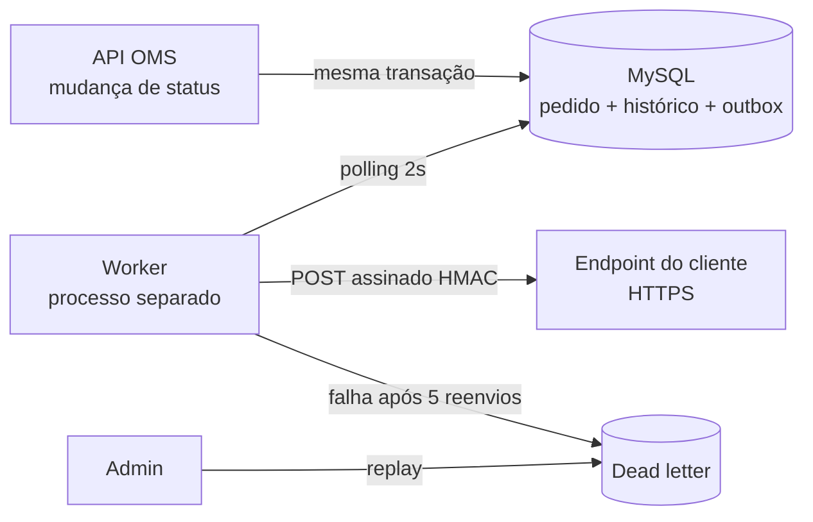

# RFC — Sistema de Webhooks de Notificação de Pedidos

| Campo | Valor |
| --- | --- |
| **Autor** | Adilson Barbosa (redação a partir da reunião técnica conduzida por Larissa, Tech Lead) |
| **Status** | Em revisão |
| **Data** | 02-11-2026 |
| **Revisores** | Larissa (Tech Lead), Marcos (Product Manager), Bruno (Eng. Pleno, Pedidos), Diego (Eng. Sênior, Plataforma), Sofia (Eng. de Segurança) |
| **Documentos relacionados** | [PRD](PRD.md) · [FDD](FDD.md) · [ADRs](adrs/README.md) · [Tracker](TRACKER.md) |

## 1. Resumo executivo (TL;DR)

Propomos notificar clientes B2B, via **webhooks HTTP de saída**, sempre que o status de um pedido muda. A mudança de status passa a registrar um evento numa **tabela outbox no MySQL existente, na mesma transação**. Um **worker em processo separado** lê essa tabela a cada 2 segundos e entrega os eventos **assinados com HMAC-SHA256**. Falhas são retentadas com **backoff exponencial** (5 reenvios ao longo de ~15 h) e, esgotadas, vão para uma **DLQ** com replay manual por administradores. A garantia é **at-least-once**, com `X-Event-Id` para deduplicação no cliente.

A proposta não adiciona infraestrutura e segue os padrões atuais do projeto. A estimativa é de **3 sprints**, incluindo a revisão de segurança.

## 2. Contexto e problema

Três clientes B2B (Atlas Comercial, MaxDistribuição e Nova Cargo) pediram formalmente para ser avisados quando o status de seus pedidos muda. Hoje eles consultam `GET /orders` periodicamente, o que deixa a integração lenta e cara. A Atlas sinalizou que pode migrar para um concorrente se a solução não sair no prazo ([09:00] Marcos), e pediu entrega até o fim de novembro ([09:45] Marcos). Para os clientes, "tempo real" é **qualquer coisa abaixo de 10 segundos** ([09:02] Marcos). O fluxo é só de saída: os clientes recebem, não enviam ([09:02] Marcos).

O OMS não tem hoje nenhum mecanismo de eventos, filas, workers ou chamadas HTTP de saída. Todas as mudanças de status passam por uma única transação no serviço de pedidos, que valida a transição na máquina de estados, movimenta estoque, atualiza o pedido e grava o histórico (`src/modules/orders/order.service.ts`, `src/modules/orders/order.status.ts`). Essa transação já é considerada pesada ([09:04] Bruno). O desafio é notificar **sem tornar essa transação dependente da rede** e **sem perder nem inventar eventos**.

## 3. Proposta técnica

**3.1 Publicação do evento.** Na transação de mudança de status, uma função de publicação recebe o contexto transacional e grava o evento na outbox, **uma entrada por webhook interessado** naquele status. O filtro por status acontece nesse momento: se nenhum webhook do cliente quer o status, nada é gravado ([09:34] Bruno). O conteúdo é um **snapshot** do pedido no instante da mudança ([09:52] Larissa). Se a gravação falhar, a mudança de status é desfeita ([09:40] Bruno). → [ADR-001](adrs/ADR-001-outbox-no-mysql.md)

**3.2 Entrega.** Um worker com ponto de entrada próprio, no mesmo banco e na mesma stack mas em outro processo, busca a cada 2 s os eventos pendentes mais antigos e faz as chamadas HTTP com timeout de 10 s ([09:09] Diego, [09:11] Larissa, [09:42] Diego). Há um único worker, e a ordem é garantida apenas por pedido. → [ADR-002](adrs/ADR-002-worker-separado-com-polling.md)

**3.3 Falhas.** Até 5 reenvios com intervalos de 1m/5m/30m/2h/12h. Depois disso, o evento vai para a tabela de dead letter, com o motivo da falha. Um endpoint administrativo restrito a ADMIN recoloca o evento na fila e registra quem fez o replay ([09:17] Larissa, [09:18] Diego, [09:36] Sofia). → [ADR-003](adrs/ADR-003-retry-com-backoff-exponencial-e-dlq.md)

**3.4 Segurança.** Corpo assinado com HMAC-SHA256 usando uma secret **por endpoint**, gerada pela plataforma e rotacionável, com a secret anterior válida por mais 24 h. Só URLs HTTPS são aceitas. O payload tem limite de 64 KB ([09:22] Sofia, [09:23] Sofia, [09:24] Larissa). → [ADR-004](adrs/ADR-004-assinatura-hmac-sha256-com-secret-por-endpoint.md)

**3.5 Semântica de entrega.** A garantia é at-least-once. Cada evento leva um UUID estável (`X-Event-Id`) para o cliente deduplicar ([09:26] Larissa). → [ADR-005](adrs/ADR-005-entrega-at-least-once-com-x-event-id.md)

**3.6 Superfície de API.** CRUD de configuração de webhooks, aberto a qualquer usuário autenticado; consulta do histórico de entregas de um webhook; e replay da DLQ, só para ADMIN ([09:31] Marcos, [09:33] Bruno, [09:34] Marcos, [09:36] Larissa, [09:37] Sofia). Contratos, payloads e códigos de erro estão no [FDD](FDD.md).

**3.7 Padrões.** O webhook é implementado como um módulo igual aos outros, reutilizando AppError, códigos `WEBHOOK_*`, o error middleware, o Pino, o Zod e o `requireRole` ([09:30] Larissa). → [ADR-006](adrs/ADR-006-reuso-dos-padroes-existentes.md)

## 4. Alternativas consideradas

| Alternativa | Por que foi descartada (trade-off) | Origem |
| --- | --- | --- |
| **Disparo síncrono** dentro da transação de status | Simples e imediato, mas um cliente lento travaria a mudança de status de outros pedidos, e um cliente fora do ar obrigaria a desfazer uma mudança válida | [09:04] Bruno, [09:06] Diego |
| **Fila externa** (Redis Streams / Redis Cluster) | Melhor para alto volume, mas exige subir e operar infraestrutura nova. É "overengineering" para um time pequeno | [09:07] Larissa, [09:07] Diego |
| **Trigger do banco** acordando o worker | Seria reativo, mas o MySQL não tem NOTIFY/LISTEN, e avisar um processo externo exigiria improviso. O polling de 2 s já atende o limite de 10 s | [09:09] Bruno, [09:09] Diego |
| **Worker dentro do processo da API** | Um processo a menos para implantar, mas reiniciar a API derrubaria as entregas | [09:11] Diego |
| **Retry indefinido** / **3 tentativas** | Retry indefinido deixaria eventos pendurados para sempre. Com 3 tentativas, a janela seria de ~30 min, insuficiente para manutenções de 2 h | [09:15] Diego, [09:16] Diego |
| **Exactly-once** | Pouparia o cliente de deduplicar, mas exige coordenação dos dois lados e fica muito mais complexo | [09:25] Diego |
| **Secret global** | Mais simples de gerir, mas o vazamento de uma secret comprometeria todos os clientes | [09:21] Sofia |

## 5. Questões em aberto

**Adiadas ou não decididas na reunião:**

1. **Rate limiting de saída por cliente.** Um cliente com 50 pedidos mudando de status em um minuto recebe 50 chamadas. Ficou definido "observar e decidir depois" ([09:38] Diego, [09:39] Larissa). *Proposta:* medir o volume por cliente após o lançamento e reabrir o tema se algum cliente reclamar.
2. **Aviso ao cliente quando o webhook falha repetidamente** (por exemplo, e-mail após falhas seguidas). Ficou fora desta fase, "talvez próxima fase, depois que a gente medir o impacto" ([09:37] Larissa).
3. **Escala para mais de um worker.** Exigiria particionar por pedido ou usar lock pessimista, e a garantia de ordem por pedido se perde sem isso. Tratado como "problema do futuro" ([09:13] Diego).
4. **Endurecer a permissão do CRUD de webhooks.** Hoje fica aberto a qualquer papel autenticado; "mais pra frente a gente pode endurecer" ([09:37] Sofia).
5. **Arquivamento da outbox** (~30 dias para eventos entregues). Ficou fora do escopo desta feature ([09:08] Diego).

**Interpretações desta proposta, a confirmar na revisão:**

6. **Contagem de tentativas.** Interpretamos "5 tentativas" como 5 **reenvios** após o envio inicial, o que usa os 5 intervalos e dá ~14,6 h, coerente com "quase 15 horas" ([09:17] Diego).
7. **Onde vai o `customer_id`.** A reunião deixou "no body ou no path" ([09:32] Larissa). Propomos body nas escritas e query string na listagem.
8. **Granularidade da outbox.** Propomos uma entrada por webhook interessado, todas com o mesmo `X-Event-Id`, para que retry, DLQ e histórico sejam por endpoint.

## 6. Impacto e riscos

**Impacto no sistema existente.** A única mudança em código atual é uma chamada a mais dentro da transação de mudança de status, mais o registro do novo módulo e das rotas. Entram também tabelas novas (configuração, outbox, dead letter, histórico de entregas), um novo processo (o worker) com script próprio e uma revisão de segurança de pelo menos 2 dias úteis antes do deploy ([09:46] Sofia).

| Risco | Prob. | Impacto | Mitigação |
| --- | --- | --- | --- |
| Cliente não deduplica e processa eventos repetidos | Média | Médio | Destacar at-least-once e `X-Event-Id` no portal do desenvolvedor ([09:26] Marcos) |
| Mudanças de status concorrentes no mesmo pedido: a transação atual não trava a linha do pedido (`src/modules/orders/order.service.ts`), então dois eventos podem ser gerados a partir do mesmo status de origem | Baixa | Médio | O evento herda a atomicidade da transação. Registrar como limitação no FDD e cobrir com teste de concorrência |
| Vazão limitada a um único worker; fila acumula em pico | Baixa | Médio | Lote pequeno e polling de 2 s cumprem < 10 s no volume atual. A escala está na questão em aberto 3 |
| Replay de DLQ protegido por `requireRole('ADMIN')`, mas o cadastro público hoje aceita o papel ADMIN (`src/modules/auth/auth.schemas.ts`) | Média | Alto | Apontar na revisão de segurança da Sofia como pré-requisito do deploy |
| Não existe vínculo entre usuário e customer, e o CRUD fica aberto a qualquer autenticado: um usuário pode gerir webhooks de outro customer | Média | Médio | Aceito "por enquanto" ([09:37] Sofia). Questão em aberto 4 |
| Vazamento de secret por parte do cliente | Média | Alto | Secret por endpoint e rotação com 24 h de convivência ([09:21] Sofia, [09:22] Diego) |
| Prazo: 3 sprints contra o pedido da Atlas para fim de novembro | Média | Alto | Escopo fechado (sem e-mail, rate limit ou dashboard) e revisão de segurança já reservada ([09:46] Larissa, [09:47] Larissa) |

## 7. Decisões relacionadas

- [ADR-001 — Padrão Outbox no MySQL](adrs/ADR-001-outbox-no-mysql.md)
- [ADR-002 — Worker em processo separado com polling de 2 s](adrs/ADR-002-worker-separado-com-polling.md)
- [ADR-003 — Retry com backoff exponencial e DLQ](adrs/ADR-003-retry-com-backoff-exponencial-e-dlq.md)
- [ADR-004 — HMAC-SHA256 com secret por endpoint](adrs/ADR-004-assinatura-hmac-sha256-com-secret-por-endpoint.md)
- [ADR-005 — At-least-once com X-Event-Id](adrs/ADR-005-entrega-at-least-once-com-x-event-id.md)
- [ADR-006 — Reuso dos padrões existentes](adrs/ADR-006-reuso-dos-padroes-existentes.md)
