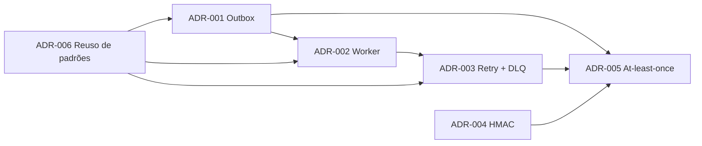

# Architectural Decision Records

Este diretório armazena os ADRs (Architectural Decision Records) do projeto.
Cada decisão arquitetural relevante é registrada em um arquivo individual no formato MADR,
nomeado como `ADR-NNN-titulo-em-kebab-case.md`.

## Sistema de Webhooks de Notificação de Pedidos

| ADR | Decisão | Status |
| --- | --- | --- |
| [ADR-001](ADR-001-outbox-no-mysql.md) | Padrão Outbox no MySQL, gravado na mesma transação da mudança de status | Aceito |
| [ADR-002](ADR-002-worker-separado-com-polling.md) | Worker em processo separado com polling de 2 s, single-worker | Aceito |
| [ADR-003](ADR-003-retry-com-backoff-exponencial-e-dlq.md) | 5 reenvios com backoff 1m/5m/30m/2h/12h e DLQ em tabela separada com replay manual | Aceito |
| [ADR-004](ADR-004-assinatura-hmac-sha256-com-secret-por-endpoint.md) | HMAC-SHA256 com secret por endpoint e rotação com convivência de 24 h | Aceito |
| [ADR-005](ADR-005-entrega-at-least-once-com-x-event-id.md) | Entrega at-least-once com `X-Event-Id` para deduplicação no cliente | Aceito |
| [ADR-006](ADR-006-reuso-dos-padroes-existentes.md) | Reuso dos padrões existentes (módulos, AppError, Pino, error middleware, Zod, requireRole) | Aceito |

### Convenções

- **Status "Aceito":** as seis decisões foram fechadas explicitamente na reunião técnica, cada uma com a fala de fechamento citada no ADR. Os detalhes de implementação que a reunião não fixou não estão nos ADRs: ficam no [FDD](../FDD.md), marcados com **[D]**, e serão confirmados no design review ([09:50] Larissa).
- ***(análise do autor)*:** marca prós, contras ou alternativas acrescentados na redação, que não foram ditos na reunião. Tudo o que não tem essa marca cita a fala de origem `[hh:mm] Nome`.

## Relações

